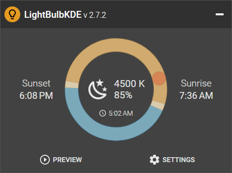

# LightBulbKDE

<p align="center">
    
</p>

**LightBulbKDE** is [LightBulb](https://github.com/Tyrrrz/LightBulb), ported to KDE Plasma on Linux.
Like the original, it warms the screen's color temperature and lowers its brightness from sunset to sunrise, with smooth transitions, location-based or manual sunrise and sunset times, and the same settings.

LightBulb does this on Windows by loading a gamma ramp into each display.
On Plasma, KWin owns the screen and no other program can do that, so LightBulbKDE drives the two controls KWin offers instead:

- **Temperature** goes through Plasma's own Night Light, held in its "Always on" mode at the temperature LightBulbKDE wants.
- **Brightness** goes through the dimming multiplier KWin keeps for every screen on top of its brightness slider. This works with HDR on, where monitors lock their own backlight.

LightBulb is the work of [Oleksii Holub](https://github.com/Tyrrrz), and this fork changes only what Linux needs.
If it's useful to you, consider [supporting the original project](https://tyrrrz.me/donate).
On Windows, use [upstream LightBulb](https://github.com/Tyrrrz/LightBulb/releases).



## Terms of use<sup>[[?]](https://github.com/Tyrrrz/.github/blob/prime/docs/why-so-political.md)</sup>

These are upstream LightBulb's terms, and they carry over to this fork.

By using this project or its source code, for any purpose and in any shape or form, you grant your **implicit agreement** to all the following statements:

- You **condemn Russia and its military aggression against Ukraine**
- You **recognize that Russia is an occupant that unlawfully invaded a sovereign state**
- You **support Ukraine's territorial integrity, including its claims over temporarily occupied territories of Crimea and Donbas**
- You **reject false narratives perpetuated by Russian state propaganda**

To learn more about the war and how you can help, [click here](https://tyrrrz.me/ukraine). Glory to Ukraine! 🇺🇦

## Requirements

- KDE Plasma 6 in a Wayland session (developed on Plasma 6.6)
- `kwriteconfig6` and `kscreen-doctor`, both of which come with Plasma
- The .NET 10 SDK to build it (on Ubuntu, `sudo apt install dotnet-sdk-10.0`)

## Install

```bash
git clone https://github.com/Laserwolve/LightBulbKDE.git
cd LightBulbKDE
./Installer/Linux/install.sh
```

The script builds a self-contained copy into `~/.local/share/LightBulbKDE` and adds LightBulbKDE to the application launcher.
Running it again updates the installed copy.
Settings are kept in `~/.config/LightBulbKDE/Settings.json`, and **Start at login** (on by default after the first run) adds an entry to `~/.config/autostart`.

## How it differs from LightBulb on Windows

- **Night Light.** LightBulbKDE switches Plasma's Night Light to "Always on" and keeps setting its temperature as the day goes. When LightBulbKDE quits, it leaves Night Light at 6500K, which is no tint at all. To hand Night Light back to Plasma's own schedule, set it to "Sunset to sunrise" in System Settings.
- **Temperature range.** Night Light only warms the screen, so temperatures run from 1000K to 6500K.
- **Brightness.** LightBulb's brightness scales gamma-encoded pixel values, while KWin's dimming scales light, so LightBulbKDE sets the dimming to the brightness raised to the power 2.2. A brightness setting therefore looks about the same as it does on Windows. KWin moves in whole percent steps and never dims all the way to black.
- **The brightness slider.** Plasma's brightness slider keeps working, and LightBulbKDE's dimming applies on top of it. Each slider change makes Plasma reset the dimming, which LightBulbKDE puts back within about 150 ms, so the screen can flash slightly brighter while you drag the slider at night.
- **Dim automatically.** Plasma's power management dims idle screens through the same multiplier, so turn off "Dim automatically" in System Settings > Power Management, or the two will undo each other.
- **Suspend.** The Suspend switch next to Night Light in Plasma's Brightness and Color applet pauses LightBulbKDE, brightness included.
- **Gamma polling** becomes a check of KWin's actual settings every second instead of every five.
- **Not available on Linux:** the application whitelist, pausing when an application is fullscreen, global hotkeys and auto-update. All four depend on the Windows API, so their settings are hidden.

## License

MIT, as upstream. See [License.txt](License.txt).
