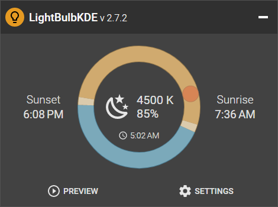

# LightBulbKDE

<p align="center">
    
</p>

**LightBulbKDE** is [LightBulb](https://github.com/Tyrrrz/LightBulb), ported to KDE Plasma on Linux.
Like the original, it warms the screen's color temperature and lowers its brightness from sunset to sunrise, with smooth transitions, location-based or manual sunrise and sunset times, and the same settings.
It can also read the light in the room through a webcam, as a phone reads its light sensor, and set both from the room instead of from the clock.

LightBulb does this on Windows by loading a gamma ramp into each display.
On Plasma, KWin owns the screen and no other program can do that, so LightBulbKDE drives the two controls KWin offers instead:

- **Temperature** goes through Plasma's own Night Light, held in its "Always on" mode at the temperature LightBulbKDE wants.
- **Brightness** goes through the dimming multiplier KWin keeps for every screen on top of its brightness slider. This works with HDR on, where monitors lock their own backlight.

LightBulb is the work of [Oleksii Holub](https://github.com/Tyrrrz), and this fork changes only what Linux needs.
If it's useful to you, consider [supporting the original project](https://tyrrrz.me/donate).
On Windows, use [upstream LightBulb](https://github.com/Tyrrrz/LightBulb/releases).



## Requirements

- KDE Plasma 6 in a Wayland session (developed on Plasma 6.6)
- `kwriteconfig6` and `kscreen-doctor`, both of which come with Plasma
- The .NET 10 SDK to build it (on Ubuntu, `sudo apt install dotnet-sdk-10.0`)
- To follow the room's light, a webcam with manual exposure, which every UVC webcam has

## Install

```bash
git clone https://github.com/Laserwolve/LightBulbKDE.git
cd LightBulbKDE
./Installer/Linux/install.sh
```

The script builds a self-contained copy into `~/.local/share/LightBulbKDE` and adds LightBulbKDE to the application launcher.
Running it again updates the installed copy.
Settings are kept in `~/.config/LightBulbKDE/Settings.json`, and **Start at login** (on by default after the first run) adds an entry to `~/.config/autostart`.

## How it differs from LightBulb on Windows

- **Night Light.** LightBulbKDE switches Plasma's Night Light to "Always on" and keeps setting its temperature as the day goes. When LightBulbKDE quits, it leaves Night Light at 6500K, which is no tint at all. To hand Night Light back to Plasma's own schedule, set it to "Sunset to sunrise" in System Settings.
- **Temperature range.** Night Light only warms the screen, so temperatures run from 1000K to 6500K.
- **Brightness.** LightBulb's brightness scales gamma-encoded pixel values, while KWin's dimming scales light, so LightBulbKDE sets the dimming to the brightness raised to the power 2.2. A brightness setting therefore looks about the same as it does on Windows. KWin moves in whole percent steps and never dims all the way to black.
- **The brightness slider.** Plasma's brightness slider keeps working, and LightBulbKDE's dimming applies on top of it. Each slider change makes Plasma reset the dimming, which LightBulbKDE puts back within about 150 ms, so the screen can flash slightly brighter while you drag the slider at night.
- **Dim automatically.** Plasma's power management dims idle screens through the same multiplier, so turn off "Dim automatically" in System Settings > Power Management, or the two will undo each other.
- **Suspend.** The Suspend switch next to Night Light in Plasma's Brightness and Color applet pauses LightBulbKDE, brightness included.
- **Gamma polling** becomes a check of KWin's actual settings every second instead of every five.
- **Ambient light.** With **Follow the room's light** on (Settings > Ambient light), the screen follows the room rather than the time of day. The room's light is read as a level from 0 in a room as dark as the dark reference to 1 in one as bright as the bright reference, in proportion to the light in stops, and the brightness is that level itself, held between the night-time and day-time brightness settings, while the color temperature runs from the night-time setting in a dark room to the day-time one in a bright room. Only the top of the frame is read, with its darkest and brightest pixels left out, and the screen's own glow, measured when the dark reference is taken, is subtracted from every reading; the screen follows the readings as a phone does, quickly when the room brightens and slowly when it darkens. Sunrise and sunset are not used while it is on, and until the first reading the room counts as bright. LightBulbKDE holds the webcam in manual exposure and keeps moving the exposure to whatever brings a small frame to a middle grey, as the camera's own metering would, so the exposure the room needs is the measure of its light. By default the camera is read every 15 seconds, for well under a second each time, and a camera another program has open is left alone; a program that opens the camera during a reading is told it is busy, and **Lend the camera** in the tray menu pauses the readings until that program is done with it. **Keep the camera on** streams a few frames a second all the time instead, for next to no load; some cameras, the Logitech C920 among them, stop answering when a new stream is asked of them within seconds of a long one stopping, which a restart of LightBulbKDE does, and then need unplugging, so it is off by default. Calibrate on the same tab, where the reading is live: make the room as dark as it gets and press DARK ROOM, then as bright as it gets and press BRIGHT ROOM. The dashboard shows the reading beside the sundial while the screen follows it.
- **Not available on Linux:** the application whitelist, pausing when an application is fullscreen, global hotkeys and auto-update. All four depend on the Windows API, so their settings are hidden.

## License

MIT, as upstream. See [License.txt](License.txt).
